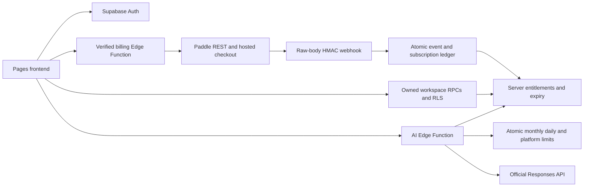

# Commercial architecture and trust boundaries

Launchpad remains a framework-free static application. `tracker.js` owns the
original tracker/backup format, `platform.js` owns career workspaces,
`navigation.js` owns the accessible drawer and `commerce.js` owns pricing,
checkout and business UI. The latter imports the existing platform, not a second
application. Public plans and operational quotas originate in `lib/plans.mjs`;
the generated SQL seed is checked against it during every build.

## Data flow

The frontend never possesses a service-role key, provider API key or signing
secret. Public Supabase/Paddle client keys are not administrative credentials.
A browser event, metadata value or localStorage plan cannot grant paid access.

## Auth, workspace and data preservation

The existing official SDK handles email/passwords, sessions, verification,
recovery and sign-out. Browser passwords are not stored manually. Server getUser
and confirmed-owner RLS remain mandatory. The static callback strips one-time
credentials, uses a fixed relative return path and supports GitHub Pages and a
commercial root/subdirectory without SPA rewrite rules.

Old guest keys/format remain unchanged. Guest records stay shared by the browser
profile; optional Free accounts provide an owned profile, not private local
career storage. A Free user explicitly selects the local organizer or account
profile. Pro/Premium protect cloud career editing. Owner-only cloud reads,
exports and deletion remain possible after cancellation; new paid collection
writes and AI require current server entitlement. Existing rows are never
truncated to new quotas. Oversized pre-existing rows are preserved by NOT VALID
bounds; new writes are bounded. Legacy grants preserve existing feature capacity
and are not revenue. Do not remove them silently.

Plan guards execute for direct inserts/updates as well as the original atomic
workspace RPC. Per-owner advisory locks serialize count quotas; revisions reject
stale writes. The Free profile-only wrapper compares all career collections with
the owned snapshot and changes only profile/preferences. Calling the older RPC
alias does not bypass table guards. AI's old unbounded monthly helper is not
callable by browser/service clients; the commercial wrapper owns the budget.

## Billing state machine

Verified account → eligibility/current terms → rate limit → owned operation UUID
reservation → provider price validation → customer mapping → transaction/plan
operation → pending browser result → verified provider event → canonical API
snapshot → atomic ledger → effective entitlement.

A new subscription must be tied to a server-authorized checkout, actual provider
transaction and recorded current-version consent. Unknown customers or unbound subscriptions are quarantined; unsupported prices return a failure for provider retry and operator review. Canonical provider data,
including customer ownership and configured monthly USD price, overrides webhook
custom data. Existing subscriptions renew/update through trusted snapshots;
provider `updated_at` protects against out-of-order state rollback. End dates are
checked with server time even if a client keeps its old UI open.

The application ledger handles duplicate requests/events without assuming an
undocumented Paddle idempotency header. Unfinished transactions are reused;
uncertain results block blind retry. Owner-bound, five-minute signed plan-change
previews include provider version, price and terms. Immediate proration is
explicitly confirmed; the provider state must still match before PATCH.

Financial tables are forced-RLS with browser-owned reads only; service-only
writes and RPC ACLs enforce privilege. Admin authorization comes solely from
`business_admins`, never user metadata or a hidden button. Business metrics use
provider records, separate sandbox labels, observed activity, real token reports
and explicit cost inputs. Missing historical/cost coverage remains unknown.

## Privacy and operational boundaries

- Payment entry is hosted by Paddle.js. No app card-number fields or card storage.
- Portal URLs are short-lived and owned; accepted destinations are provider HTTPS
  hosts. Pending checkout links are rebound to the signed-in owner before opening.
- Account changes clear business/billing views and invalidate pending operations
  in the UI, including A→logout→A sessions. The server derives all customer IDs.
- Deletion blocks active/unconfirmed financial operations to avoid orphan charges.
  Required minimal financial/consent records may be retained separately; career
  data deletion and guest retention follow the existing policy.
- Optional conversion counts and early-access records require explicit consent;
  analytics withdrawal deletes owned pricing-view records. No third-party
  marketing tracker or automated outreach was installed.
- AI context/history are opt-in; request limits and output bounds remain enforced.
  Token reports use actual response usage; dollar amounts are labeled estimates
  from operator rates, not invoices. Failed attempts consume request credits.
- Raw webhook bytes are bounded before decoding. HMAC verification precedes JSON
  processing and privileged clients. Client/company/job strings use text nodes;
  remaining HTML templates/icons are static. Redirects are fixed or provider-host
  allowlisted. Server JSON operations use bound parameters and fixed identifiers.

A formal penetration test, legal compliance certification, age verification,
provider approval and live-mailbox proof are not supplied by these controls.
Monitor quarantines, unmatched operations and cost-report coverage before launch.
