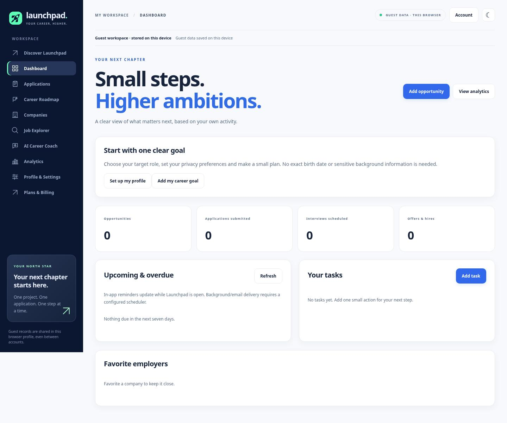
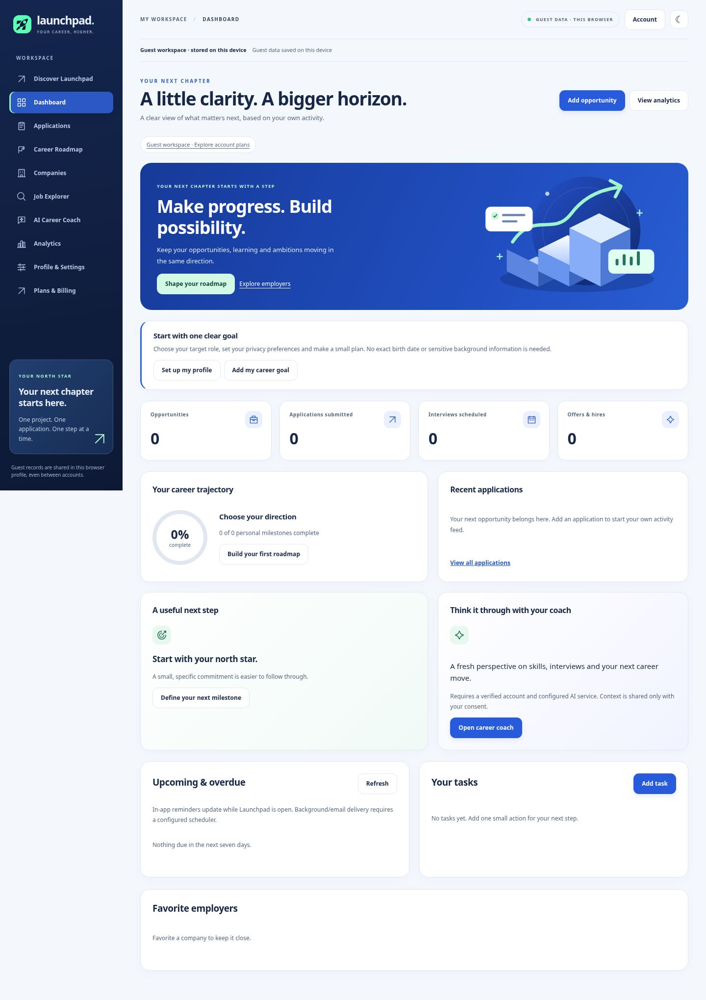

# Launchpad 5.1 — real before/after captures

These are actual Chromium screenshots of the local app, not design mockups.
Before: `3e2e993`, source app. After: 5.1 compiled static artifact served under the
GitHub Pages project prefix, using a fresh guest workspace. No test applications,
customer identities, revenue or hiring metrics were inserted for these captures.
Desktop width: 1440px. Mobile width: 375px. Tall images show full-page content.
The images do not prove hosted staging, email, AI, job-feed or purchase delivery.

| Screen | Before | After |
| --- | --- | --- |
| Dashboard, desktop | [Before](before-dashboard-desktop.jpg) | [After](after-dashboard-desktop.jpg) |
| Dashboard, mobile | [Before](before-dashboard-mobile.jpg) | [After](after-dashboard-mobile.jpg) |
| Companies, desktop | [Before](before-companies-desktop.jpg) | [After](after-companies-desktop.jpg) |
| Companies, mobile | [Before](before-companies-mobile.jpg) | [After](after-companies-mobile.jpg) |
| Landing, desktop | [Before](before-home-desktop.jpg) | [After](after-home-desktop.jpg) |
| Landing, mobile | [Before](before-home-mobile.jpg) | [After](after-home-mobile.jpg) |
| Billing, desktop | [Before](before-billing-desktop.jpg) | [After](after-billing-desktop.jpg) |
| Billing, mobile | [Before](before-billing-mobile.jpg) | [After](after-billing-mobile.jpg) |

Dashboard comparison:

| Before | After |
| --- | --- |
|  |  |

Additional desktop/mobile captures cover Applications, Career Roadmap, Job
Explorer, AI Coach, Analytics, Settings and the account dialog. Dashboard dark
captures demonstrate the separate theme. All generated images are review
artifacts and excluded from the public application allowlist. Only the authentic
product-preview image is deployed as an app asset.
