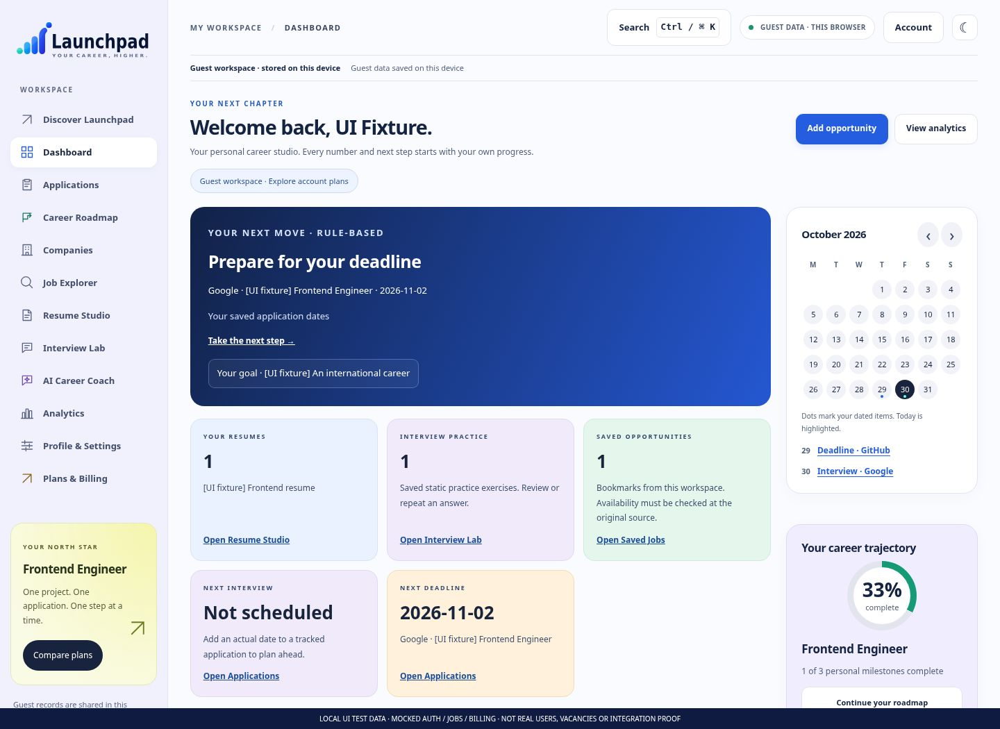
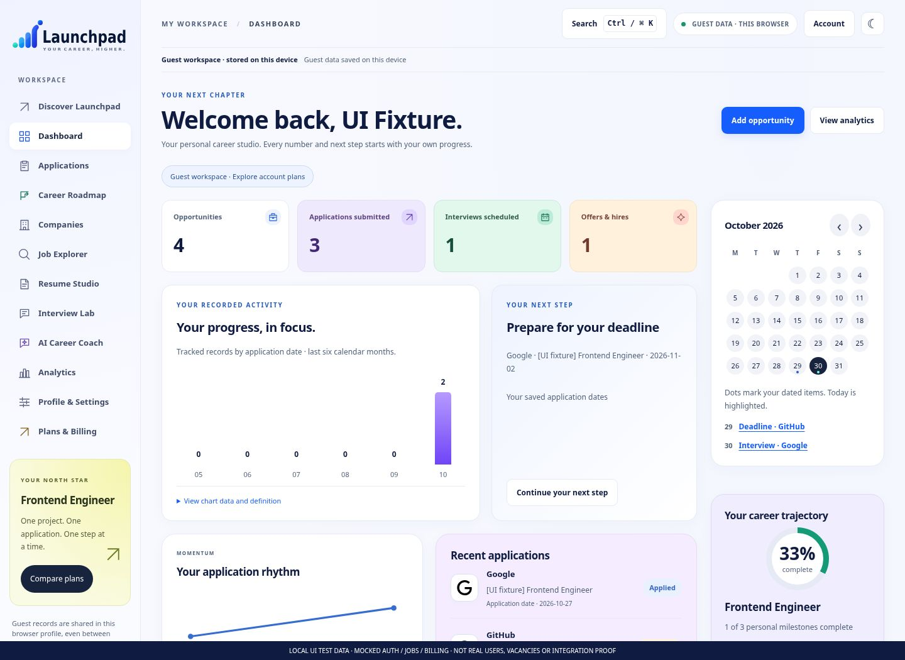

# Launchpad 5.7 — real before/after browser captures

**78 actual rendered Chromium screenshots.** Before: 5.6 `499f0ac`; after: 5.7 working build. The [manifest](manifest.json) records UTC capture time, artifact hash, dimensions, theme and errors.

Every screenshot is watermarked **LOCAL UI TEST DATA / MOCKED AUTH, JOBS AND BILLING**. These are test fixtures, not real customers, verified current vacancies, purchased plans or live integration evidence. No AI response is simulated in the images. The supplied concept images are references, not captured website output.

## Dashboard comparison

Before 5.6 (labelled local fixture):

After 5.7 (the same labelled local fixture):

## Every screen

| Screen | Before 5.6 desktop | After desktop light | After desktop dark | After mobile light | After mobile dark |
|---|---|---|---|---|---|
| Discover | [View](before-home-light-1440.jpg) | [View](after-home-light-1440.jpg) | [View](after-home-dark-1440.jpg) | [View](after-home-light-390.jpg) | [View](after-home-dark-390.jpg) |
| Login | [View](before-login-light-1440.jpg) | [View](after-login-light-1440.jpg) | [View](after-login-dark-1440.jpg) | [View](after-login-light-390.jpg) | [View](after-login-dark-390.jpg) |
| Registration | [View](before-registration-light-1440.jpg) | [View](after-registration-light-1440.jpg) | [View](after-registration-dark-1440.jpg) | [View](after-registration-light-390.jpg) | [View](after-registration-dark-390.jpg) |
| Dashboard | [View](before-dashboard-light-1440.jpg) | [View](after-dashboard-light-1440.jpg) | [View](after-dashboard-dark-1440.jpg) | [View](after-dashboard-light-390.jpg) | [View](after-dashboard-dark-390.jpg) |
| Applications | [View](before-applications-light-1440.jpg) | [View](after-applications-light-1440.jpg) | [View](after-applications-dark-1440.jpg) | [View](after-applications-light-390.jpg) | [View](after-applications-dark-390.jpg) |
| Career Roadmap | [View](before-roadmap-light-1440.jpg) | [View](after-roadmap-light-1440.jpg) | [View](after-roadmap-dark-1440.jpg) | [View](after-roadmap-light-390.jpg) | [View](after-roadmap-dark-390.jpg) |
| Companies | [View](before-companies-light-1440.jpg) | [View](after-companies-light-1440.jpg) | [View](after-companies-dark-1440.jpg) | [View](after-companies-light-390.jpg) | [View](after-companies-dark-390.jpg) |
| Job Explorer | [View](before-jobs-light-1440.jpg) | [View](after-jobs-light-1440.jpg) | [View](after-jobs-dark-1440.jpg) | [View](after-jobs-light-390.jpg) | [View](after-jobs-dark-390.jpg) |
| Resume Studio | [View](before-resume-light-1440.jpg) | [View](after-resume-light-1440.jpg) | [View](after-resume-dark-1440.jpg) | [View](after-resume-light-390.jpg) | [View](after-resume-dark-390.jpg) |
| Interview Lab | [View](before-interview-light-1440.jpg) | [View](after-interview-light-1440.jpg) | [View](after-interview-dark-1440.jpg) | [View](after-interview-light-390.jpg) | [View](after-interview-dark-390.jpg) |
| AI Career Coach | [View](before-coach-light-1440.jpg) | [View](after-coach-light-1440.jpg) | [View](after-coach-dark-1440.jpg) | [View](after-coach-light-390.jpg) | [View](after-coach-dark-390.jpg) |
| Analytics | [View](before-analytics-light-1440.jpg) | [View](after-analytics-light-1440.jpg) | [View](after-analytics-dark-1440.jpg) | [View](after-analytics-light-390.jpg) | [View](after-analytics-dark-390.jpg) |
| Profile & Settings | [View](before-settings-light-1440.jpg) | [View](after-settings-light-1440.jpg) | [View](after-settings-dark-1440.jpg) | [View](after-settings-light-390.jpg) | [View](after-settings-dark-390.jpg) |
| Plans & Billing | [View](before-billing-light-1440.jpg) | [View](after-billing-light-1440.jpg) | [View](after-billing-dark-1440.jpg) | [View](after-billing-light-390.jpg) | [View](after-billing-dark-390.jpg) |

Additional views:

- Tablet 768px: [Dashboard](after-dashboard-light-768.jpg), [Jobs](after-jobs-light-768.jpg), [Settings](after-settings-light-768.jpg), [Billing](after-billing-light-768.jpg).
- Kanban: [light](after-applications-kanban-light-1440.jpg), [dark](after-applications-kanban-dark-1440.jpg).
- Career preferences: [light](after-settings-preferences-light-1440.jpg), [dark](after-settings-preferences-dark-1440.jpg).

The same labelled dataset, dimensions and theme are used for the desktop before/after comparison. Mobile means 390px; desktop 1440px. The fixed watermark is a capture-only overlay, not shipped product UI. Data displayed in these images must not be used as marketing metrics.

Visual review: the 5.7 composition prioritizes actual metrics and charts before older preparation panels, adds a globe hero, refines sidebar/cards/form surfaces and gives Resume/Interview workbenches more coherent structure. It deliberately omits fabricated scores, fake social login, employer endorsements and invented AI answers. The [release report](../../LAUNCHPAD_5_7_RELEASE_REPORT.md) describes remaining limits.

Reproduce: create an isolated archive of commit `499f0ac`, set `LAUNCHPAD_BASELINE_DIR` to that directory, run a fresh `npm run build`, then `node scripts/capture57.cjs`. This executor used `CHROMIUM_PATH=/usr/bin/chromium`. The script blocks unhandled external requests and aborts for page/console errors, failed local assets or horizontal overflow. No deployment is performed.
