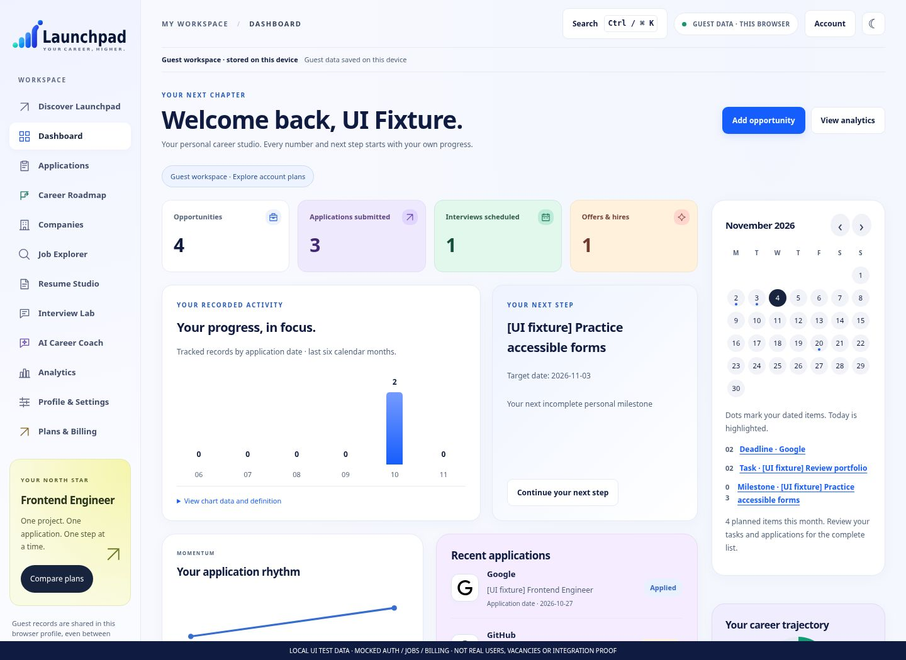
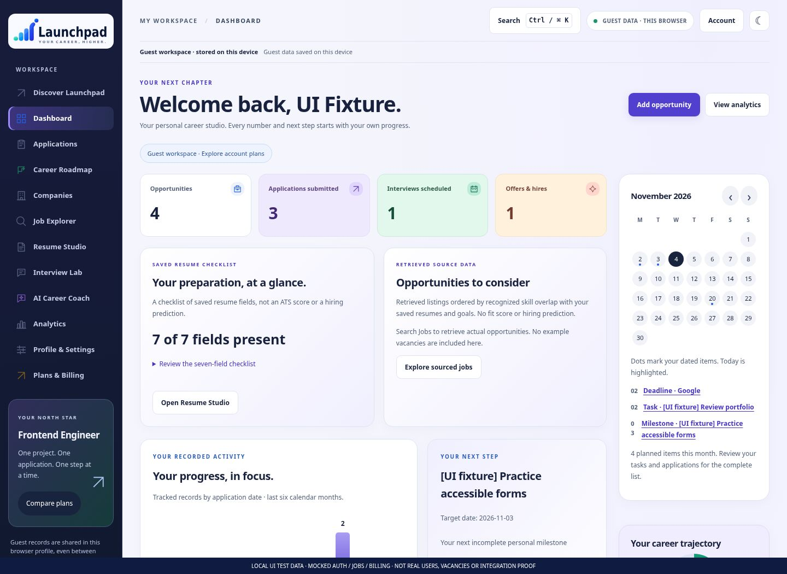
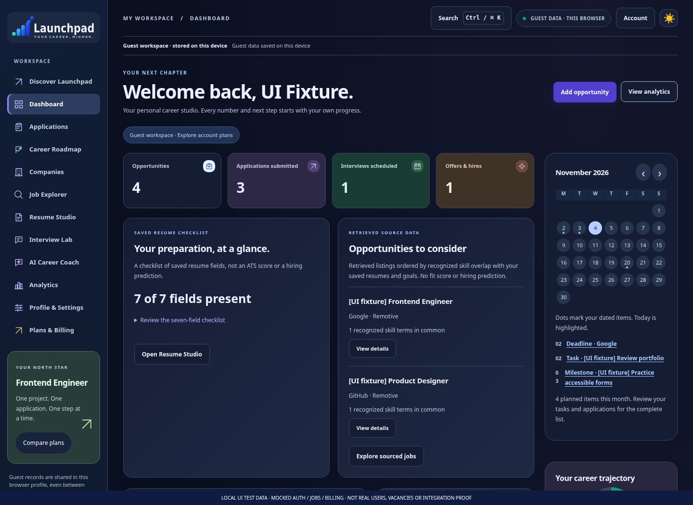

# Launchpad 5.8 — real browser evidence

**102 screenshots** of actual rendered UI. Before: 5.7 `7e412e0`. After: 5.8. [Capture manifest](manifest.json).

All fixture images carry a visible **LOCAL UI TEST DATA / MOCKED AUTH, JOBS AND BILLING** watermark. They are not real customers, current vacancies, purchased plans or proof of live APIs. Scripted product-tour dialogs additionally label themselves DEMO ONLY and never populate workspace/provider data.

No new 5.8 reference image accompanied the brief. These comparisons demonstrate actual changes against 5.7 and the requested navy/indigo direction, not a claim of exact matching against an unavailable screenshot.

## Dashboard before / after

## All screens

| Screen | Before 5.7 desktop | After desktop light | After desktop dark | After mobile light | After mobile dark |
|---|---|---|---|---|---|
| Discover | [View](before-home-light-1440.jpg) | [View](after-home-light-1440.jpg) | [View](after-home-dark-1440.jpg) | [View](after-home-light-390.jpg) | [View](after-home-dark-390.jpg) |
| Login | [View](before-login-light-1440.jpg) | [View](after-login-light-1440.jpg) | [View](after-login-dark-1440.jpg) | [View](after-login-light-390.jpg) | [View](after-login-dark-390.jpg) |
| Registration | [View](before-registration-light-1440.jpg) | [View](after-registration-light-1440.jpg) | [View](after-registration-dark-1440.jpg) | [View](after-registration-light-390.jpg) | [View](after-registration-dark-390.jpg) |
| Dashboard | [View](before-dashboard-light-1440.jpg) | [View](after-dashboard-light-1440.jpg) | [View](after-dashboard-dark-1440.jpg) | [View](after-dashboard-light-390.jpg) | [View](after-dashboard-dark-390.jpg) |
| Applications | [View](before-applications-light-1440.jpg) | [View](after-applications-light-1440.jpg) | [View](after-applications-dark-1440.jpg) | [View](after-applications-light-390.jpg) | [View](after-applications-dark-390.jpg) |
| Career Roadmap | [View](before-roadmap-light-1440.jpg) | [View](after-roadmap-light-1440.jpg) | [View](after-roadmap-dark-1440.jpg) | [View](after-roadmap-light-390.jpg) | [View](after-roadmap-dark-390.jpg) |
| Companies | [View](before-companies-light-1440.jpg) | [View](after-companies-light-1440.jpg) | [View](after-companies-dark-1440.jpg) | [View](after-companies-light-390.jpg) | [View](after-companies-dark-390.jpg) |
| Jobs | [View](before-jobs-light-1440.jpg) | [View](after-jobs-light-1440.jpg) | [View](after-jobs-dark-1440.jpg) | [View](after-jobs-light-390.jpg) | [View](after-jobs-dark-390.jpg) |
| Resume Studio | [View](before-resume-light-1440.jpg) | [View](after-resume-light-1440.jpg) | [View](after-resume-dark-1440.jpg) | [View](after-resume-light-390.jpg) | [View](after-resume-dark-390.jpg) |
| Interview Lab | [View](before-interview-light-1440.jpg) | [View](after-interview-light-1440.jpg) | [View](after-interview-dark-1440.jpg) | [View](after-interview-light-390.jpg) | [View](after-interview-dark-390.jpg) |
| AI Career Coach | [View](before-coach-light-1440.jpg) | [View](after-coach-light-1440.jpg) | [View](after-coach-dark-1440.jpg) | [View](after-coach-light-390.jpg) | [View](after-coach-dark-390.jpg) |
| Analytics | [View](before-analytics-light-1440.jpg) | [View](after-analytics-light-1440.jpg) | [View](after-analytics-dark-1440.jpg) | [View](after-analytics-light-390.jpg) | [View](after-analytics-dark-390.jpg) |
| Profile & Settings | [View](before-settings-light-1440.jpg) | [View](after-settings-light-1440.jpg) | [View](after-settings-dark-1440.jpg) | [View](after-settings-light-390.jpg) | [View](after-settings-dark-390.jpg) |
| Plans & Billing | [View](before-billing-light-1440.jpg) | [View](after-billing-light-1440.jpg) | [View](after-billing-dark-1440.jpg) | [View](after-billing-light-390.jpg) | [View](after-billing-dark-390.jpg) |

## New interactions and responsive detail

- Retrieved recommendations: [light 1440px](after-dashboard-sourced-light-1440.jpg), [light 390px](after-dashboard-sourced-light-390.jpg), [dark 1440px](after-dashboard-sourced-dark-1440.jpg), [dark 390px](after-dashboard-sourced-dark-390.jpg).
- Job details and comparison: [light 1440px](after-jobs-details-light-1440.jpg), [light 390px](after-jobs-details-light-390.jpg), [dark 1440px](after-jobs-details-dark-1440.jpg), [dark 390px](after-jobs-details-dark-390.jpg).
- Resume/job comparison preparation: [light 1440px](after-jobs-comparison-light-1440.jpg), [light 390px](after-jobs-comparison-light-390.jpg), [dark 1440px](after-jobs-comparison-dark-1440.jpg), [dark 390px](after-jobs-comparison-dark-390.jpg).
- Session history: [light 1440px](after-jobs-history-light-1440.jpg), [light 390px](after-jobs-history-light-390.jpg), [dark 1440px](after-jobs-history-dark-1440.jpg), [dark 390px](after-jobs-history-dark-390.jpg).
- Isolated jobs demo: [light 1440px](after-jobs-demo-light-1440.jpg), [light 390px](after-jobs-demo-light-390.jpg), [dark 1440px](after-jobs-demo-dark-1440.jpg), [dark 390px](after-jobs-demo-dark-390.jpg).
- Scripted assistant demo: [light 1440px](after-coach-demo-light-1440.jpg), [light 390px](after-coach-demo-light-390.jpg), [dark 1440px](after-coach-demo-dark-1440.jpg), [dark 390px](after-coach-demo-dark-390.jpg).

- Tablet: [Dashboard](after-dashboard-light-768.jpg), [Jobs](after-jobs-light-768.jpg), [Settings](after-settings-light-768.jpg), [Billing](after-billing-light-768.jpg).
- Kanban: [light](after-applications-kanban-light-1440.jpg), [dark](after-applications-kanban-dark-1440.jpg).
- Preferences: [light](after-settings-preferences-light-1440.jpg), [dark](after-settings-preferences-dark-1440.jpg).

The script checks local assets, page/console errors and horizontal overflow. Each before/after uses the same labelled fixture dataset. Watermarks are capture-only overlays, not deployed UI. The [report](../../LAUNCHPAD_5_8_RELEASE_REPORT.md) explains real functionality, privacy and unverified integrations.

Reproduce with an isolated `git archive 7e412e0`, set `LAUNCHPAD_BASELINE_DIR` to that archive directory, run `npm run build`, then `node scripts/capture58.cjs`. This executor used `CHROMIUM_PATH=/usr/bin/chromium`. No deployment is performed.
