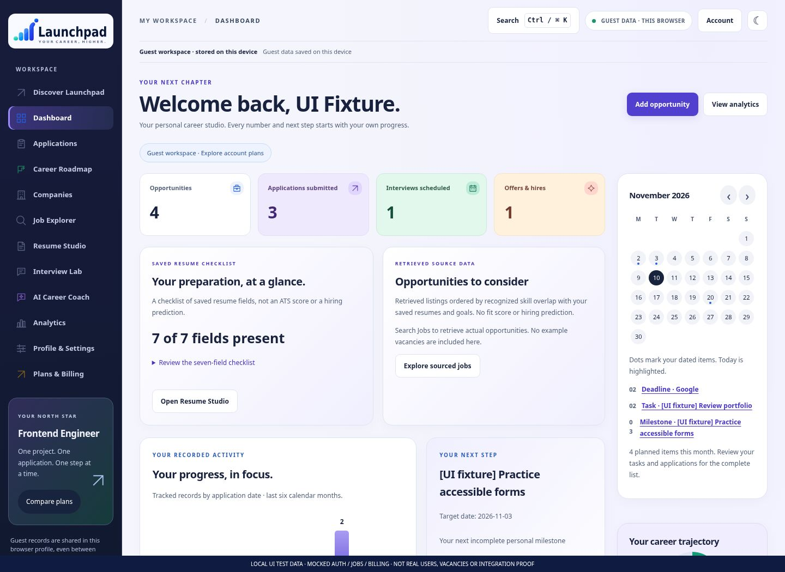
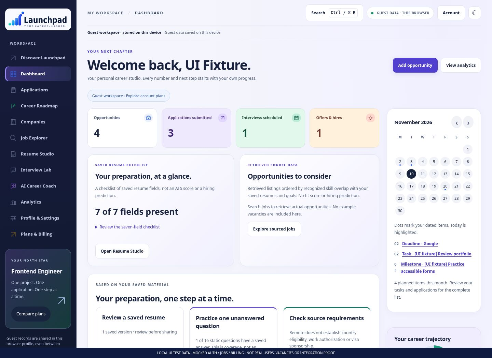
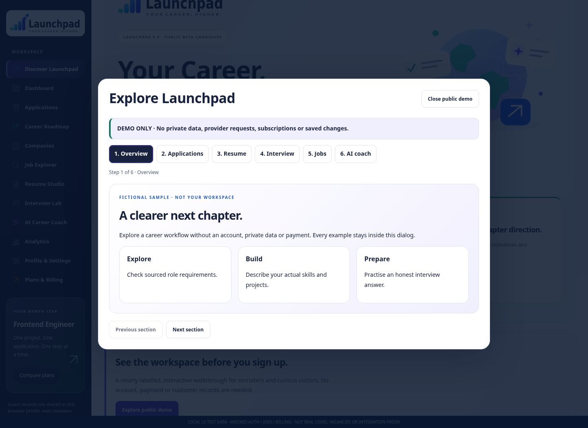
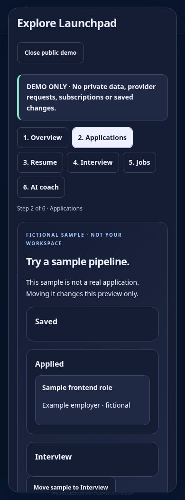

# Launchpad 5.9 — real browser evidence

**146 actual Chromium screenshots**, baseline 5.8 `47839ed` and new 5.9. Every fixture capture is visibly watermarked: local UI test data, mocked Auth/jobs/billing, not real people/vacancies or integration proof. No screenshot is a mockup embedded as application UI.

[Capture manifest](manifest.json) records dimensions, theme, stage, errors, local asset failures, overflow and SHA-256 of the rendered public build manifest. All captures completed with zero recorded issues. The capture runner uses a clean Git archive of the baseline and a freshly built `_site` for the new version.

## Before and after

The identity is preserved. New preparation/source panels and the public walkthrough are functional. Screens not otherwise changed retain their established layout; shared status contrast improves populated activity. No new reference image accompanied the 5.9 request.

| Screen | 5.8 desktop | 5.9 desktop light | Desktop dark | Mobile light | Mobile dark |
|---|---|---|---|---|---|
| Discover | [View](before-home-light-1440.jpg) | [View](after-home-light-1440.jpg) | [View](after-home-dark-1440.jpg) | [View](after-home-light-390.jpg) | [View](after-home-dark-390.jpg) |
| Login | [View](before-login-light-1440.jpg) | [View](after-login-light-1440.jpg) | [View](after-login-dark-1440.jpg) | [View](after-login-light-390.jpg) | [View](after-login-dark-390.jpg) |
| Registration | [View](before-registration-light-1440.jpg) | [View](after-registration-light-1440.jpg) | [View](after-registration-dark-1440.jpg) | [View](after-registration-light-390.jpg) | [View](after-registration-dark-390.jpg) |
| Dashboard | [View](before-dashboard-light-1440.jpg) | [View](after-dashboard-light-1440.jpg) | [View](after-dashboard-dark-1440.jpg) | [View](after-dashboard-light-390.jpg) | [View](after-dashboard-dark-390.jpg) |
| Applications | [View](before-applications-light-1440.jpg) | [View](after-applications-light-1440.jpg) | [View](after-applications-dark-1440.jpg) | [View](after-applications-light-390.jpg) | [View](after-applications-dark-390.jpg) |
| Roadmap | [View](before-roadmap-light-1440.jpg) | [View](after-roadmap-light-1440.jpg) | [View](after-roadmap-dark-1440.jpg) | [View](after-roadmap-light-390.jpg) | [View](after-roadmap-dark-390.jpg) |
| Companies | [View](before-companies-light-1440.jpg) | [View](after-companies-light-1440.jpg) | [View](after-companies-dark-1440.jpg) | [View](after-companies-light-390.jpg) | [View](after-companies-dark-390.jpg) |
| Job Explorer | [View](before-jobs-light-1440.jpg) | [View](after-jobs-light-1440.jpg) | [View](after-jobs-dark-1440.jpg) | [View](after-jobs-light-390.jpg) | [View](after-jobs-dark-390.jpg) |
| Resume Studio | [View](before-resume-light-1440.jpg) | [View](after-resume-light-1440.jpg) | [View](after-resume-dark-1440.jpg) | [View](after-resume-light-390.jpg) | [View](after-resume-dark-390.jpg) |
| Interview Lab | [View](before-interview-light-1440.jpg) | [View](after-interview-light-1440.jpg) | [View](after-interview-dark-1440.jpg) | [View](after-interview-light-390.jpg) | [View](after-interview-dark-390.jpg) |
| AI Coach | [View](before-coach-light-1440.jpg) | [View](after-coach-light-1440.jpg) | [View](after-coach-dark-1440.jpg) | [View](after-coach-light-390.jpg) | [View](after-coach-dark-390.jpg) |
| Analytics | [View](before-analytics-light-1440.jpg) | [View](after-analytics-light-1440.jpg) | [View](after-analytics-dark-1440.jpg) | [View](after-analytics-light-390.jpg) | [View](after-analytics-dark-390.jpg) |
| Settings | [View](before-settings-light-1440.jpg) | [View](after-settings-light-1440.jpg) | [View](after-settings-dark-1440.jpg) | [View](after-settings-light-390.jpg) | [View](after-settings-dark-390.jpg) |
| Plans & Billing | [View](before-billing-light-1440.jpg) | [View](after-billing-light-1440.jpg) | [View](after-billing-dark-1440.jpg) | [View](after-billing-light-390.jpg) | [View](after-billing-dark-390.jpg) |

## Public portfolio walkthrough

All examples are fictional and stay inside the dialog; no real workspace, provider call or payment is simulated as successful. Mobile scroll resets on section changes so the Close control remains reachable.

| Demo section | Desktop light | Desktop dark | Mobile light | Mobile dark |
|---|---|---|---|---|
| Overview | [View](after-public-demo-1-light-1440.jpg) | [View](after-public-demo-1-dark-1440.jpg) | [View](after-public-demo-1-light-390.jpg) | [View](after-public-demo-1-dark-390.jpg) |
| Applications | [View](after-public-demo-2-light-1440.jpg) | [View](after-public-demo-2-dark-1440.jpg) | [View](after-public-demo-2-light-390.jpg) | [View](after-public-demo-2-dark-390.jpg) |
| Resume templates | [View](after-public-demo-3-light-1440.jpg) | [View](after-public-demo-3-dark-1440.jpg) | [View](after-public-demo-3-light-390.jpg) | [View](after-public-demo-3-dark-390.jpg) |
| Interview structure | [View](after-public-demo-4-light-1440.jpg) | [View](after-public-demo-4-dark-1440.jpg) | [View](after-public-demo-4-light-390.jpg) | [View](after-public-demo-4-dark-390.jpg) |
| Isolated job example entry | [View](after-public-demo-5-light-1440.jpg) | [View](after-public-demo-5-dark-1440.jpg) | [View](after-public-demo-5-light-390.jpg) | [View](after-public-demo-5-dark-390.jpg) |
| Scripted coach entry | [View](after-public-demo-6-light-1440.jpg) | [View](after-public-demo-6-dark-1440.jpg) | [View](after-public-demo-6-light-390.jpg) | [View](after-public-demo-6-dark-390.jpg) |

## Focused controls and additional evidence

- Public entry: [light 1440px](after-home-public-entry-light-1440.jpg), [dark 1440px](after-home-public-entry-dark-1440.jpg), [light 390px](after-home-public-entry-light-390.jpg), [dark 390px](after-home-public-entry-dark-390.jpg).
- Dashboard preparation: [light 1440px](after-dashboard-preparation-light-1440.jpg), [dark 1440px](after-dashboard-preparation-dark-1440.jpg), [light 390px](after-dashboard-preparation-light-390.jpg), [dark 390px](after-dashboard-preparation-dark-390.jpg).
- Saved resume export: [light 1440px](after-resume-preparation-light-1440.jpg), [dark 1440px](after-resume-preparation-dark-1440.jpg), [light 390px](after-resume-preparation-light-390.jpg), [dark 390px](after-resume-preparation-dark-390.jpg).
- Interview coverage: [light 1440px](after-interview-preparation-light-1440.jpg), [dark 1440px](after-interview-preparation-dark-1440.jpg), [light 390px](after-interview-preparation-light-390.jpg), [dark 390px](after-interview-preparation-dark-390.jpg).
- International source facts: [light 1440px](after-jobs-source-facts-light-1440.jpg), [dark 1440px](after-jobs-source-facts-dark-1440.jpg), [light 390px](after-jobs-source-facts-light-390.jpg), [dark 390px](after-jobs-source-facts-dark-390.jpg).
- Retrieved recommendations: [light 1440px](after-dashboard-sourced-light-1440.jpg), [dark 1440px](after-dashboard-sourced-dark-1440.jpg), [light 390px](after-dashboard-sourced-light-390.jpg), [dark 390px](after-dashboard-sourced-dark-390.jpg).
- Job details: [light 1440px](after-jobs-details-light-1440.jpg), [dark 1440px](after-jobs-details-dark-1440.jpg), [light 390px](after-jobs-details-light-390.jpg), [dark 390px](after-jobs-details-dark-390.jpg).
- Existing job tour: [light 1440px](after-jobs-demo-light-1440.jpg), [dark 1440px](after-jobs-demo-dark-1440.jpg), [light 390px](after-jobs-demo-light-390.jpg), [dark 390px](after-jobs-demo-dark-390.jpg).
- Existing coach tour: [light 1440px](after-coach-demo-light-1440.jpg), [dark 1440px](after-coach-demo-dark-1440.jpg), [light 390px](after-coach-demo-light-390.jpg), [dark 390px](after-coach-demo-dark-390.jpg).

Additional tablet, Kanban, career preferences, comparison and recent-history captures:

- [after-applications-kanban-light-1440.jpg](after-applications-kanban-light-1440.jpg)
- [after-jobs-comparison-light-1440.jpg](after-jobs-comparison-light-1440.jpg)
- [after-jobs-history-light-1440.jpg](after-jobs-history-light-1440.jpg)
- [after-settings-preferences-light-1440.jpg](after-settings-preferences-light-1440.jpg)
- [after-jobs-comparison-light-390.jpg](after-jobs-comparison-light-390.jpg)
- [after-jobs-history-light-390.jpg](after-jobs-history-light-390.jpg)
- [after-applications-kanban-dark-1440.jpg](after-applications-kanban-dark-1440.jpg)
- [after-jobs-comparison-dark-1440.jpg](after-jobs-comparison-dark-1440.jpg)
- [after-jobs-history-dark-1440.jpg](after-jobs-history-dark-1440.jpg)
- [after-settings-preferences-dark-1440.jpg](after-settings-preferences-dark-1440.jpg)
- [after-jobs-comparison-dark-390.jpg](after-jobs-comparison-dark-390.jpg)
- [after-jobs-history-dark-390.jpg](after-jobs-history-dark-390.jpg)
- [after-dashboard-light-768.jpg](after-dashboard-light-768.jpg)
- [after-jobs-light-768.jpg](after-jobs-light-768.jpg)
- [after-settings-light-768.jpg](after-settings-light-768.jpg)
- [after-billing-light-768.jpg](after-billing-light-768.jpg)

Reproduce with `LAUNCHPAD_BASELINE_DIR` pointing to an isolated `git archive 47839ed`, a fresh `npm run build` and `CHROMIUM_PATH=/usr/bin/chromium node scripts/capture59.cjs`. No site deployment occurs. The images do not prove SMTP, live jobs, AI output, hosted RLS, sandbox checkout or actual account data.
